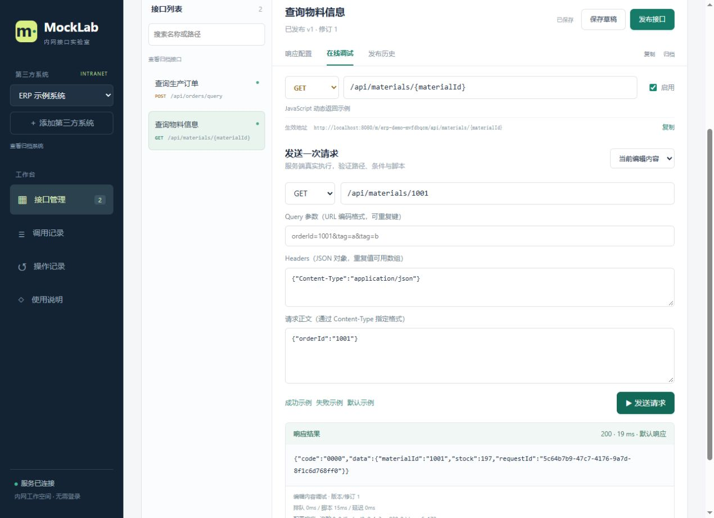

# MockLab 首版开发验收记录

日期：2026-10-19

## 1. 交付状态

源码、运行 JAR、数据库初始化脚本、前端构建配置、Linux Docker Compose 与部署教程已保存到 `G:\project\mock-platform`。原有 prototype 和需求文档保留。

本机运行实例从该项目的 release 目录启动，数据位于该项目 data 目录，访问地址为 http://127.0.0.1:8080。演示系统包含真实发布的订单查询和 JavaScript 物料查询接口。

## 2. 编译与自动化测试

| 检查 | 结果 |
| --- | --- |
| Vue / Vite 生产构建 | 通过，无公网资源依赖 |
| Maven 双模块编译与打包 | 通过 |
| EngineContractTest | 15 项，0 失败、0 错误 |
| LogWriterContractTest | 2 项，0 失败、0 错误 |
| 运行 JAR 校验和 | 17 个 JAR 与 SHA256SUMS.json 一致 |
| Compose YAML 解析 | 通过，确认执行容器 network_mode 为 none |
| ServiceImpl 方法长度检查 | 方法体有效代码不超过 20 行 |

日志数据库故障单元测试会故意输出一条 database unavailable 错误日志，用于验证日志落库失败不影响业务响应，不代表测试失败。

## 3. 真实 HTTP 验收

`scripts/integration_test.py` 在最终交付实例运行，57 项检查全部通过。原始输出见 [HTTP 验收输出](HTTP验收输出.txt)。

覆盖范围包括：

- 系统创建、重复标识、未发布接口和系统停用
- 原样报文 UTF-8 内容、空白和换行保留，自定义响应头
- 草稿隔离、修订冲突、发布切换、回滚生成新版本并保留草稿
- 成功、失败、默认场景与路径参数、重复 Query 参数、表单解析
- UUID v4、JSON null、HEAD 正文省略、显式 OPTIONS
- 静态路径优先于参数路径，方法错误不回退，末尾斜杠区别
- 非法 JSON、二进制请求、超大请求/响应、默认场景和参数路由冲突
- 响应头协议限制和 CR/LF 注入拒绝
- 脚本异常、缺失 body、BigInt、循环引用、异步返回拒绝
- 死循环超时后销毁与恢复，内存耗尽受控失败，静态接口继续可用
- 脚本文件、网络和进程对象不可访问，控制台输出不干扰监督协议
- 路径变更释放旧地址，回滚冲突不改变当前发布状态
- 归档立即停止接口，恢复后必须重新发布
- 调用摘要持久化，默认不保存正文

额外执行 `scripts/capacity_test.py`：140 个并发 HTTP 请求访问每次计算约 400ms 的脚本接口，实际结果为 16 个 HTTP 200、124 个 HTTP 503，约 1.86 秒完成。503 为预期的有界队列/等待限制拒绝，验证超额请求被控制；该结果不是正常负载错误率或吞吐性能基准。

## 4. 页面及持久化检查

已通过真实浏览器操作验证：

1. 空工作空间创建演示系统，接口实际发布
2. 页面在线调试返回原样成功报文和 JavaScript 动态数据
3. 调用记录展示来源、状态、场景、耗时和发布版本
4. 有未保存修改时新增系统或切换接口弹出保存/放弃/取消提示
5. 选择取消后内容保留，明确放弃后正确切换，不隐式保存
6. 重启后系统、两个接口和各自发布版本 v1 均保留
7. 重启后真实脚本 HTTP 调用成功，综合健康状态 UP

## 5. 尚未在目标环境验证的范围

当前 Windows 机器没有 Docker，不能把本机验收当作 Linux 生产部署验收。以下项目需要在目标 Linux Docker 服务器执行：

- MySQL 8.4 容器初始化、权限及数据库连接
- Linux Unix Socket 卷权限、容器健康探针与重启
- Docker 无网络配置实际生效、CPU/内存/进程配额
- 离线镜像构建、导入、断公网运行
- 独立环境 MySQL 备份、恢复与入口切换
- 按需求建议服务器配置执行持续负载、p95、吞吐与长时间稳定性验证
- 从另一台业务服务器通过内网域名/端口调用

日志超期及总量分批清理已实现，尚未通过制造百万行数据进行容量级验收。本记录不声称需求文档全部 37 个验收场景在生产环境完成。

## 6. 可复现入口

- 单元/契约测试：`mvn -B test`
- 真实 HTTP 验收：`python scripts/integration_test.py`
- 超额脚本负载：`python scripts/capacity_test.py`
- 本机运行：见根目录 README
- Linux 与离线部署、备份恢复：见部署教程

HTTP 测试脚本只新建并归档自己的命名空间，不删除其他配置。测试数据保留在归档系统和调用记录中，可按正常保留策略清理。
